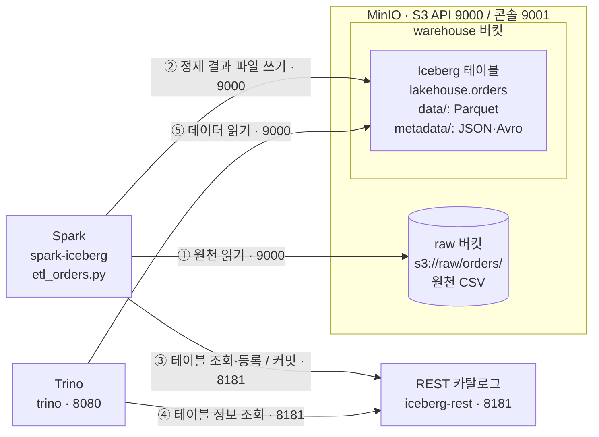

# 4주차 산출물 — 레이크하우스 아키텍처

## 1. 구성

Ubuntu WSL2에서 Docker Compose로 MinIO, Spark, REST 카탈로그, Trino를 구성했다. Iceberg는 독립 서버가 아니라 MinIO에 저장된 데이터와 메타데이터를 테이블로 관리하는 포맷이다.

| 구성 요소 | 실제 구성 및 역할 | 포트 | 없으면 |
|---|---|---|---|
| MinIO | minio 컨테이너. raw에 원천 CSV, warehouse에 테이블 파일 저장 | 9000(S3 API), 9001(콘솔) | 현재 구성의 공통 저장소가 없어진다 |
| Iceberg | lakehouse.orders의 데이터·메타데이터·스냅샷 관리 | — | 파일의 테이블 상태와 스냅샷을 관리하기 어렵다 |
| REST 카탈로그 | iceberg-rest 컨테이너. 테이블 이름과 최신 메타데이터 위치 연결 | 8181 | 두 엔진이 공유하는 테이블 탐색·커밋 경로가 없어진다 |
| Spark | spark-iceberg 컨테이너. 원천 읽기, 정제, MERGE 적재 | — | 현재 ETL 작업을 수행할 엔진이 없어진다 |
| Trino | trino 컨테이너. SQL 조회·집계 | 8080 | 현재 구성의 대화형 분석 경로가 없어진다 |

Spark 3.5.5 / Iceberg 1.8.1, REST 카탈로그 이미지 1.6.0, Trino 483을 사용한다. 두 엔진의 카탈로그 주소는 http://rest:8181, S3 주소는 http://minio:9000이다. Spark에서는 demo.lakehouse.orders, Trino에서는 iceberg.lakehouse.orders로 접근한다. 실제 orders 저장 경로는 s3://warehouse/lakehouse/orders이다.

## 2. 아키텍처 다이어그램



화살표는 요청 방향이다. 번호는 대표 처리 순서를 나타내며, Spark의 카탈로그 조회는 파일 쓰기 전에도 발생한다.

## 3. 데이터 흐름

1. 원천 CSV를 MinIO의 raw/orders/ 경로에 저장한다.
2. Spark가 s3a로 CSV를 읽고 주문 ID·금액·날짜의 타입을 변환한다. 주문 ID가 없거나 금액이 음수·NULL인 행을 제외한다.
3. 주문 ID별로 거래일 내림차순, 원천 파일 경로 내림차순으로 정렬해 한 행을 남긴다. 정제 결과를 localCheckpoint(eager=True)로 확정한다.
4. MERGE INTO로 기존 주문 ID는 갱신하고 새로운 주문 ID는 삽입한다. 같은 입력을 반복 처리해도 주문 ID별 결과가 유지되도록 구성했다.
5. Iceberg 파일을 저장한 후 REST 카탈로그에 커밋한다. 커밋된 스냅샷이 테이블의 조회 상태가 된다.
6. Trino가 같은 카탈로그에서 테이블 정보를 얻고 MinIO의 Iceberg 데이터를 읽어 조회·집계한다.

## 4. 검증한 것

### 4.1 ETL 수정 직후 검증

실행 결과는 다음과 같다.

```text
원천 행: 5
정제 후 행: 4
total rows: 4
```

추가 SQL 검증에서 행 수 4, 고유 주문 ID 수 4, 금액 합계 120000.0을 확인했다. 행 수와 고유 키 수가 같아 해당 시점에 주문 ID 중복이 없었다.

### 4.2 산출물 작성 시점의 두 엔진 비교

ETL 직후 검증과 작성 시점은 구분했다. 작성 시점에는 아래 결과를 각각 직접 조회했다.

| 검증 항목 | Spark | Trino | 결과 |
|---|---:|---:|---|
| 전체 행 수 | 7 | 7 | 일치 |
| 고유 주문 ID 수 | 7 | 7 | 일치·중복 없음 |
| 금액 합계 | 192000.0 | 192000.0 | 일치 |
| 스냅샷 개수 | 12 | 12 | 일치 |

Spark 데이터 검증 SQL:

```sql
SELECT count(*) AS n_rows,
       count(DISTINCT order_id) AS n_keys,
       sum(amount) AS total
FROM demo.lakehouse.orders;

SELECT count(*) AS n_snapshots
FROM demo.lakehouse.orders.snapshots;
```

Trino 데이터 검증 SQL:

```sql
SELECT count(*) AS n_rows,
       count(DISTINCT order_id) AS n_keys,
       sum(amount) AS total
FROM iceberg.lakehouse.orders;

SELECT count(*) AS n_snapshots
FROM iceberg.lakehouse."orders$snapshots";
```

두 엔진에서 동일한 테이블의 집계와 스냅샷 수가 일치하는 것을 확인했다. Trino INSERT 직후 Spark 조회, Spark ALTER/UPDATE 직후 Trino 확인, 실패 전후 스냅샷 비교는 이번 산출물 작성 과정에서 별도 재현하지 않았으므로 검증 완료 항목에 포함하지 않았다.

## 5. 발견한 이슈와 해결

### MERGE 오류로 total rows 미출력

처음에는 원천 행과 정제 후 행만 출력되고 total rows가 출력되지 않았다. 실행 명령의 grep이 특정 문구만 남겨 실제 오류를 숨겼다. 전체 로그를 확인하니 MERGE 단계에서 아래 오류가 발생했다.

```text
INVALID_NON_DETERMINISTIC_EXPRESSIONS
```

원천 파일명을 얻는 input_file_name()은 Spark에서 비결정적 표현식으로 취급된다. src_file 컬럼을 제거한 뒤에도 처리 계획에 해당 표현식이 남아 있어 현재 환경의 MERGE 분석 단계에서 실패했다. 단순 cache()만으로는 해결되지 않았다.

임시 뷰 생성 전에 다음 코드를 추가해 정제 결과와 이전 처리 계획을 분리했다.

```python
clean = clean.localCheckpoint(eager=True)
print("정제 후 행:", clean.count(), flush=True)
clean.createOrReplaceTempView("updates")
```

수정 후 재실행하여 total rows: 4까지 정상 출력되는 것을 확인했다. 수정 전 원본은 etl_orders.py.bak으로 보관했다. 이 오류는 MERGE 분석 단계에서 발생했으므로 해당 MERGE의 파일 쓰기·커밋 이전 실패이며, 파일 쓰기 중 실패를 재현한 실험과는 구분한다.

### Spark 경고 메시지 구분

NativeCodeLoader 경고 이후에도 쿼리는 정상 완료됐다. SparkUI의 4040·4041 포트 충돌은 사용 가능한 다른 포트로 자동 변경되었으며, 데이터 검증 실패는 아니었다.

## 6. 한계와 다음 단계

- raw/orders/ 전체를 매번 다시 읽는다. 날짜별 경로와 처리 완료 배치 기록을 이용해 신규 입력만 처리하도록 개선한다.
- 파이프라인을 수동 실행한다. 8주차 Airflow에서 실행 순서·재시도·실패 알림을 관리한다.
- grep으로 요약 문구만 보면 오류가 가려진다. tee로 전체 로그를 보관하고 파이프라인 종료 코드도 확인한다.
- 거래일과 파일 경로가 모두 같은 중복 행은 현재 정렬 기준만으로 우선순위를 완전히 결정할 수 없다. 수집 시각이나 배치 ID 등 명확한 추가 기준을 둔다.
- localCheckpoint는 현재 실행의 로컬 저장에 의존한다. 장애 복구가 필요한 운영 환경에서는 영속적인 중간 저장 또는 신뢰할 수 있는 체크포인트 경로를 검토한다.
- 원천에서 삭제된 주문은 현재 MERGE 구문으로 대상에서 삭제되지 않는다. 삭제 반영이 필요하면 별도 정책을 설계한다.
