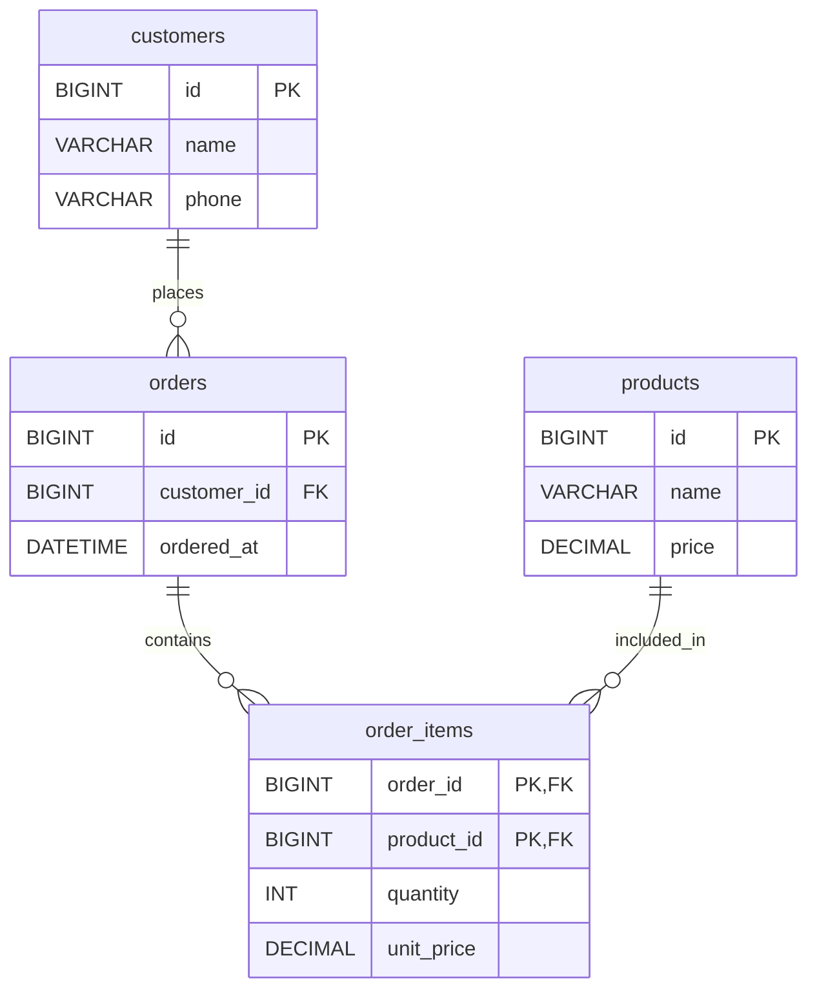

# 쇼핑몰 ERD 설계서

## 1. 개요

- **목적:** 회원, 상품, 주문, 주문 상세 정보를 관계형 데이터베이스로 관리한다.
- **DBMS:** MySQL 8 기준
- **엔터티 수:** 4개 (`customers`, `products`, `orders`, `order_items`)
- **설계 원칙:** 참조 무결성 유지, 중복 데이터 최소화, 주문 당시 판매가격 보존

## 2. ERD

> ERD의 `o{` 표기는 관계상 0개 이상의 자식 행이 존재할 수 있음을 뜻한다. 업무 규칙상 주문에 상품이 반드시 하나 이상 포함되어야 한다면 주문 생성 트랜잭션에서 별도 검증이 필요하다.

## 3. 엔터티 정의

| 엔터티 | 설명 | 기본키(PK) |
|---|---|---|
| `customers` | 회원 기본 정보 | `id` |
| `products` | 판매 상품 정보 | `id` |
| `orders` | 주문 한 건의 기본 정보 | `id` |
| `order_items` | 주문에 포함된 상품과 구매 당시 가격 | (`order_id`, `product_id`) |

### 3.1 컬럼 명세

#### customers

| 컬럼 | 데이터 타입 | 제약조건 | 설명 |
|---|---|---|---|
| `id` | BIGINT | PK | 회원 식별자 |
| `name` | VARCHAR(100) | NOT NULL | 회원명 |
| `phone` | VARCHAR(30) | NULL 허용 | 전화번호 |

#### products

| 컬럼 | 데이터 타입 | 제약조건 | 설명 |
|---|---|---|---|
| `id` | BIGINT | PK | 상품 식별자 |
| `name` | VARCHAR(200) | NOT NULL | 상품명 |
| `price` | DECIMAL(12,2) | NOT NULL | 현재 판매가격 |

#### orders

| 컬럼 | 데이터 타입 | 제약조건 | 설명 |
|---|---|---|---|
| `id` | BIGINT | PK | 주문 식별자 |
| `customer_id` | BIGINT | NOT NULL, FK | 주문 회원 → `customers.id` |
| `ordered_at` | DATETIME | NOT NULL | 주문 일시 |

#### order_items

| 컬럼 | 데이터 타입 | 제약조건 | 설명 |
|---|---|---|---|
| `order_id` | BIGINT | PK, FK | 주문 → `orders.id` |
| `product_id` | BIGINT | PK, FK | 상품 → `products.id` |
| `quantity` | INT | NOT NULL | 주문 수량 |
| `unit_price` | DECIMAL(12,2) | NOT NULL | 주문 당시 상품 단가 |

> 본래 제공된 요구사항에 없던 `name`, `phone`, `price`, `ordered_at`, `quantity` 등은 예시 컬럼이며, 첨부한 `shopping_mall_erd.sql`과 동일하게 맞췄다.

## 4. 엔터티 관계 및 외래키

| 부모 테이블 | 자식 테이블 | 관계 | FK | 삭제 정책 |
|---|---|---|---|---|
| `customers` | `orders` | 1:N | `orders.customer_id` → `customers.id` | RESTRICT |
| `orders` | `order_items` | 1:N | `order_items.order_id` → `orders.id` | RESTRICT |
| `products` | `order_items` | 1:N | `order_items.product_id` → `products.id` | RESTRICT |

- 회원 한 명은 여러 주문을 생성할 수 있다.
- 한 주문에 여러 상품이 들어갈 수 있고, 상품 하나는 여러 주문에 등장할 수 있다.
- `orders`와 `products`의 N:M 관계를 교차 엔터티 `order_items`로 해소한다.
- `order_items` 복합 PK로 동일 주문·동일 상품 조합의 중복 저장을 방지한다. 같은 상품 여러 개는 `quantity`로 표현한다.

## 5. 정규화 근거

1. **회원 정보 분리:** 고객 이름·전화번호 등을 `orders`에 반복 저장하지 않고 `customers`에서 관리해 전화번호 변경 시 한 곳만 수정하도록 한다. 갱신 이상을 줄인다.
2. **주문 상세 분리:** 주문별 상품 목록을 하나의 문자열 컬럼에 저장하지 않고 `order_items`의 개별 행으로 분리하여 제1정규형(1NF)을 충족한다. 상품별 조회·집계·조인이 쉬워진다.
3. **복합키의 역할:** 주문과 상품의 조합이 주문 상세를 식별하므로 `order_items`에 `(order_id, product_id)`를 PK로 설정한다.

## 6. 주문 가격 보존 결정

- **컬럼:** `order_items.unit_price`
- **목적:** `products.price`가 추후 바뀌더라도 과거 주문 당시의 판매 단가를 유지한다.
- **처리 원칙:** 주문 생성 트랜잭션에서 단가를 복사해 기록하고, 상품 가격 변경과 연동해 과거 주문 단가를 갱신하지 않는다.
- **주의:** `unit_price`의 변경 금지는 현 DDL만으로 강제되지 않는다. 변경 권한 제한 또는 애플리케이션 검증을 추가해야 한다.

## 7. 참조 무결성 검증

| 시나리오 | 기대 결과 | 근거 |
|---|---|---|
| 존재하지 않는 고객 ID로 `orders` INSERT | 차단 (`1452`) | FK 참조 위반 |
| 주문이 존재하는 고객 DELETE | 차단 (`1451`) | `ON DELETE RESTRICT` |

위 두 시나리오는 사용자 제공 설계서에서 **검증 완료**로 보고된 항목이다. 이 문서를 만들면서 DB에서 재실행한 것은 아니다.

## 8. 추가 권장 제약조건

현재 SQL 파일에는 포함하지 않았으며, 실제 운영 설계 시 검토한다.

- `order_items.quantity > 0` CHECK 제약조건
- `products.price >= 0`, `order_items.unit_price >= 0` CHECK 제약조건
- 주문 상세가 최소 1건 이상이어야 한다는 업무 규칙은 주문 등록 트랜잭션에서 검증
- 고객 조회 성능을 위한 `orders(customer_id)` 인덱스 검토 (InnoDB는 FK 지원용 인덱스가 필요하며 자동 생성될 수 있음)

## 9. 연관 파일

- `shopping_mall_erd.sql` — MySQL 8 테이블 및 외래키 정의
- `ERD_설계서.md` — 구조, 관계, 정규화 및 검증 근거
