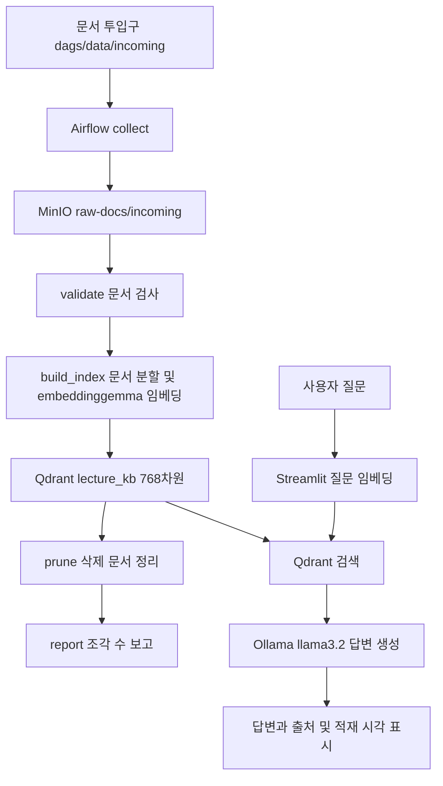
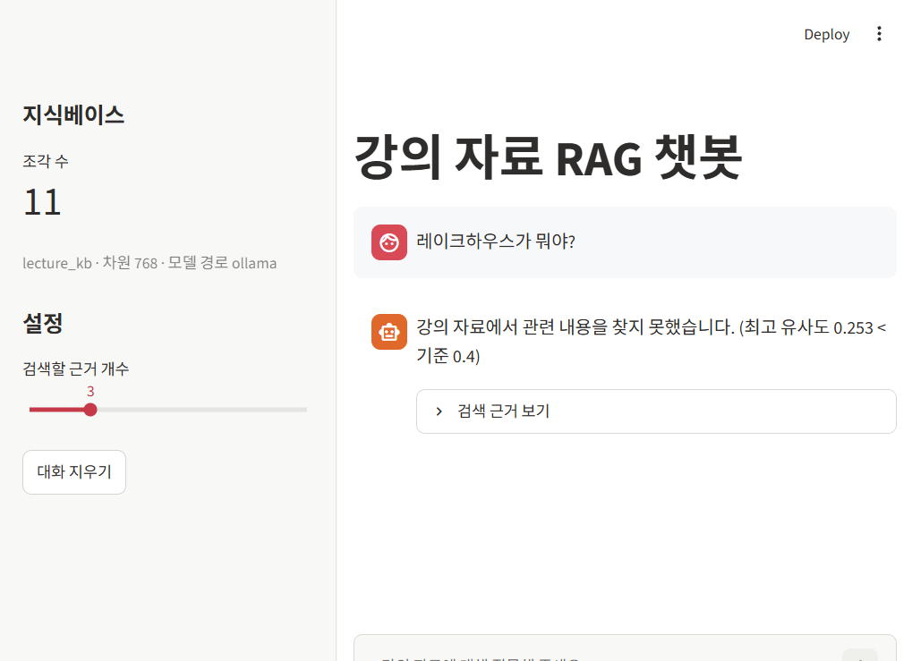
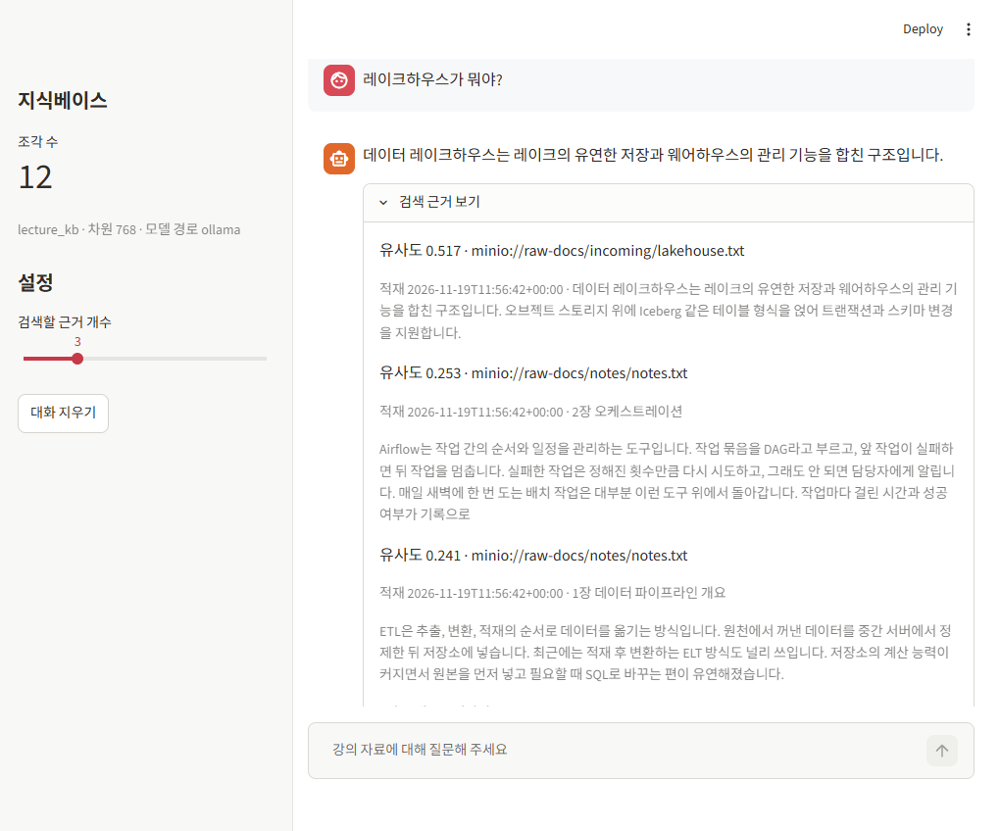

# 강의 자료 RAG 챗봇

Airflow가 문서를 수집·검증·색인하고 Streamlit 챗봇이 검색 근거로 답한다. 현재 설정은 Ollama, embeddinggemma(768차원), llama3.2, Qdrant의 `lecture_kb` 컬렉션이다.

## 아키텍처



최종 DAG는 매일 실행하며 실패 시 1분 간격으로 최대 2회 재시도한다. 조각에는 `ingested_at`을 기록한다. 챗봇은 최고 검색 점수가 기준값 `0.4`보다 낮으면 관련 자료를 찾지 못했다는 메시지를 표시한다.

## 제출 파일

```text
submit/
├── rag_pipeline_final.py
├── build_kb.py
├── minio_env.py
├── rag_env.py
├── app.py
├── requirements.txt
├── .env.example
└── README.md
```

총 8개 파일이다. 실제 인증값이 있는 `.env`는 제출하지 않는다.

## 실행 순서

기존 실습의 Docker 컨테이너와 Airflow Compose 환경을 사용한다. DAG와 관련 Python 파일은 `~/airflow-lab/dags/`에 배치한다. 명령은 Ubuntu 또는 WSL Bash에서 실행한다.

### 1. 컨테이너 및 네트워크

```bash
docker start ollama qdrant rag-minio
docker exec ollama ollama pull llama3.2
docker exec ollama ollama pull embeddinggemma
docker network inspect airflow-lab_default
```

Airflow 네트워크가 없으면 `~/airflow-lab`에서 `docker compose create`로 먼저 생성한다. 아직 연결되지 않은 컨테이너를 연결한다. 이미 연결되어 있으면 중복 연결 오류가 나올 수 있다.

```bash
docker network connect airflow-lab_default ollama
docker network connect airflow-lab_default qdrant
docker network connect airflow-lab_default rag-minio
```

호스트 Ollama 서비스와 Docker Ollama가 11434 포트로 충돌하면 `sudo systemctl stop ollama`로 호스트 서비스를 중지한 뒤 연결한다.

### 2. Airflow 실행

현재 환경은 추가 Compose 파일로 워커에 Ollama 설정을 전달한다. 아래 설정을 저장하고 실행한다. 제출한 Python 파일만으로 Airflow 환경 전체가 생성되지는 않으며 기존 Compose 환경이 필요하다.

```bash
cd ~/airflow-lab
cat > compose.rag-worker.yaml <<'EOF'
services:
  airflow-worker:
    environment:
      LLM_PROVIDER: "ollama"
      COLLECTION: "lecture_kb"
      OLLAMA_HOST: "http://ollama:11434"
      QDRANT_URL: "http://qdrant:6333"
      MINIO_ENDPOINT: "rag-minio:9000"
      _PIP_ADDITIONAL_REQUIREMENTS: "minio qdrant-client python-dotenv langchain-text-splitters langchain-ollama langchain-openai"
EOF

docker compose -f docker-compose.yaml -f compose.rag-worker.yaml up -d
af() { docker compose exec -T airflow-scheduler airflow "$@" < /dev/null; }
af dags reserialize
af dags list-import-errors
af dags pause rag_pipeline
af dags unpause rag_pipeline_final
af dags trigger rag_pipeline_final
```

시작 시 패키지 설치에 몇 분 걸릴 수 있다. 기존 `rag_pipeline`은 일시정지하고 최종 DAG를 사용한다.

### 3. 챗봇 실행

```bash
cd ~/data-eng/week8
source .venv/bin/activate
python -m pip install -r submit/requirements.txt
export LLM_PROVIDER=ollama
export COLLECTION=lecture_kb
export OLLAMA_HOST=http://localhost:11434
export QDRANT_URL=http://localhost:6333
python -m streamlit run app.py
```

브라우저에서 `http://localhost:8501`을 연다. 설정을 변경하면 Streamlit을 재시작한다.

## 검증 시나리오

### 1. 대조군 기록

`lakehouse.txt` 투입 전에 “레이크하우스가 뭐야?”를 질문하고 답변과 최고 유사도를 기록한다. 이미 투입했다면 추가 전 기록을 사용한다.

### 2. 새 문서 투입

```bash
cd ~/airflow-lab
cat > dags/data/incoming/lakehouse.txt <<'EOF'
데이터 레이크하우스는 레이크의 유연한 저장과 웨어하우스의 관리 기능을 합친 구조입니다.
오브젝트 스토리지 위에 Iceberg 같은 테이블 형식을 얹어 트랜잭션과 스키마 변경을 지원합니다.
EOF
af dags trigger rag_pipeline_final
```

### 3. 실행 완료와 답변 반영 확인

아래 실행 ID 자리에 트리거 출력의 실제 `manual__...` 값을 넣는다.

```bash
af tasks states-for-dag-run rag_pipeline_final '실제_manual__실행ID' -o plain
curl -sS -X POST \
  http://localhost:6333/collections/lecture_kb/points/count \
  -H 'Content-Type: application/json' -d '{"exact":true}'
echo
```

다섯 태스크가 모두 성공한 뒤 같은 질문을 보낸다. 답변이 새 문서를 반영하고 검색 근거에 `minio://raw-docs/incoming/lakehouse.txt`와 적재 시각이 표시되는지 확인한다. 같은 문서 구성이라면 조각 수가 11에서 12로 증가하는 것이 예상된다.

### 4. 멱등 검증

문서를 바꾸지 않고 `af dags trigger rag_pipeline_final`로 다시 실행한다. 모든 태스크 성공 후 조각 수가 12를 유지하는지 확인한다. 적재 시각은 새 실행 시각으로 갱신된다.

## 검증 기록

2026-11-19에 현재 조각 수와 검색 점수를 직접 확인했다. 문서 투입 전후 화면에서도 11 → 12조각, 최고 유사도 0.253 → 0.517과 새 문서 근거의 답변 반영을 확인했다. 재실행 전후 개수 비교는 별도 확인 항목으로 남겼다. 교재 유사도는 참고값이며 질문과 모델에 따라 달라진다.

| 항목 | 교재 참고값 | 내 실측 결과 |
|---|---|---|
| 문서 추가 전 조각 수 | 11 | 11 확인 |
| 문서 추가 후 조각 수 | 12 | 12 확인 |
| 추가 전 최고 유사도 | 0.253 | 0.253, 첨부 화면 확인 |
| 추가 후 최고 유사도 | 0.517 | 0.516953 (표시값 0.517), lakehouse.txt 1위 |
| 재실행 후 조각 수 | 12 유지 | 확인 후 기록 |
| 최종 DAG 상태 | 다섯 태스크 success | 최근 실행 success 확인 |

## 설정 확인

DAG와 챗봇은 같은 컬렉션 및 임베딩 모델을 사용한다. 현재는 `lecture_kb`와 `embeddinggemma` 768차원이다. 교재와 동일하게 `lecture_kb`를 사용한다.

호스트의 챗봇은 `localhost`로 접속하고 Airflow 워커는 `ollama`, `qdrant`, `rag-minio`라는 컨테이너 이름으로 접속한다. 실제 `.env`와 인증값은 제출 파일에서 제외한다.


## 검증 화면

문서 투입 전에는 관련 자료를 찾지 못했고, 투입 후에는 lakehouse.txt를 근거로 답변했다.





초기 별도 컬렉션에서 질문 문구가 달랐던 결과는 additional-before.png에 보관했다.


## GitHub 제출본의 인증 설정

제출본의 minio_env.py는 MINIO_ACCESS_KEY와 MINIO_SECRET_KEY 환경 변수로 MinIO 인증값을 읽는다. 실제 값은 로컬 .env 또는 컨테이너 환경 변수에 설정한다. 호스트에서 직접 실행할 때는 rag_env를 불러오기 전에 dotenv로 .env를 읽거나 셸에 두 변수를 export한다. Airflow에서는 airflow-worker의 환경 변수로 전달한다. 실제 인증값과 .env는 저장소에 올리지 않는다.

## 저장소에서 파일 배치

이 폴더의 app.py와 rag_env.py는 챗봇 코드이며, 상위 ../airflow-lab 폴더에는 민감값을 제거한 Compose 설정과 dags 실행 코드가 있다. 기존 실습 경로를 사용할 때는 airflow-lab/dags의 Python 파일을 ~/airflow-lab/dags/에, Compose 파일 두 개를 ~/airflow-lab/에 복사한다.

Airflow의 .env.example을 로컬 .env로 복사하고 빈 인증 설정을 직접 채운다. AIRFLOW_DATABASE_URL에는 PostgreSQL 접속 문자열을 넣으며 POSTGRES_PASSWORD와 일치해야 한다. 기존 데이터베이스를 사용할 때는 기존 비밀번호와 FERNET_KEY 및 JWT 설정을 유지한다. 예시 파일에는 실제 인증값을 포함하지 않았다. 현재 제출본으로 기존 실습 환경을 덮어쓰기 전에 로컬 인증 설정을 맞춘다.

제출 폴더의 코드 8개 구성 외에 검증 화면 evidence/와 재현용 ../airflow-lab/을 함께 제공한다. 로그, 가상환경, MinIO 문서 원본, 실제 .env 및 인증값은 제외했다.
